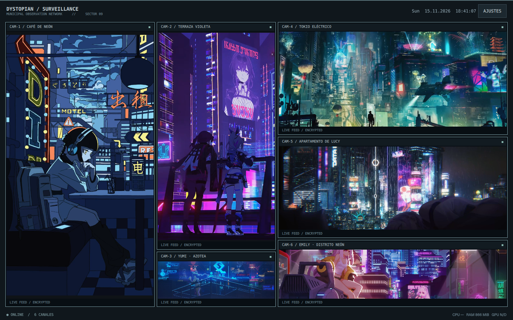

# Dystopian Surveillance Desktop

Un escritorio de cámaras anime/cyberpunk animadas e interactivas para **Arch Linux + Hyprland**.
Quickshell/QML, Qt Multimedia y un único servicio Python local. Español por defecto.

**Estado: 0.1.0, implementación inicial con validación de integración pendiente en
Arch/Hyprland.** No se presenta como una versión certificada para uso diario.
Consulta [VALIDATION.md](docs/VALIDATION.md) para distinguir pruebas ejecutadas
de comprobaciones que necesitan una sesión real del compositor.



## Instalar

```bash
git clone https://github.com/waqetdf/dystopian-surveillance-desktop.git
cd dystopian-surveillance-desktop
chmod +x install.sh
./install.sh
```

El repositorio puede ser privado: utiliza tu autenticación habitual de GitHub.
Ejecuta el instalador **como tu usuario**, no con `sudo`. Solo `pacman` solicita
privilegios. Se usan los repositorios oficiales firmados de Arch, sin AUR ni
scripts descargados y ejecutados mediante una tubería. Si faltan dependencias,
se hace `pacman -Syu --needed` para evitar una actualización parcial de Arch.
La instalación del núcleo no depende de proveedores de vídeos. Se incluyen tus
dos archivos aportados; las otras cuatro cámaras conservan sus menús y diálogos
y muestran «Elegir vídeo» hasta asignarles uno. Lee la propuesta de cambios y
confirma la instalación. La colección adicional es opcional: `./install.sh
--with-curated-media`, o el botón correspondiente en Ajustes → Animaciones.

Después, dentro de Hyprland:

```bash
~/.local/bin/dsd start
~/.local/bin/dsd settings
~/.local/bin/dsd doctor
~/.local/bin/dsd status
```

También se añade **SUPER + SHIFT + D**, un acceso en el lanzador de aplicaciones
y el arranque automático en la siguiente sesión. No se sustituye `hyprland.conf`:
se añade un bloque delimitado que carga un archivo independiente. Si usas un
archivo Hyprland alternativo mediante `--config`, añade ese `source` al archivo
que realmente cargas. El instalador admite la ruta XDG estándar.

## Qué incluye

- Tus dos MP4 originales y una selección opcional de cuatro vídeos similares encontrados en la web.
  Escenas anime/cyberpunk, miniaturas y procedencia documentada. Los medios de
  terceros se pueden descargar localmente con SHA-256, sin redistribuir los archivos
  en Git. Código MIT; licencias de medios independientes.
- Mosaico asimétrico adaptable, editor gráfico de posición/tamaño, división y
  eliminación de paneles, perfiles y restauración de la distribución inicial.
- Un solo menú de escena abierto globalmente, transición de expansión,
  posicionamiento según espacio disponible y fondo opaco.
- Aplicaciones reales mediante `subprocess.Popen(argv)` sin intérprete de shell.
  Terminal, navegador, archivos, mpv, htop, ajustes y accesos personalizados.
- Biblioteca por categorías, previsualización, importación local de vídeo/GIF/APNG,
  paquetes de escenas sin código, encuadre, velocidad, repetición y silencio.
- Diálogos locales con varias intervenciones y eventos por apertura, tiempo,
  azar, hora, memoria de visitas y aplicaciones. Probabilidad y espera editables.
- Pérdida de señal visual, interferencia progresiva y reconexión por cámara.
- Ambiente interpolado según la hora local, líneas CRT y estética industrial.
- Ocho secciones de configuración, aplicación en caliente de la mayoría de
  ajustes y escritura atómica de preferencias.
- IA opcional, desactivada de fábrica; proveedor HTTPS configurable, modelo,
  contexto e historial limitado. Claves exclusivamente en Secret Service.
- Ahorro manual y automático por CPU, batería y pantalla completa; métricas
  de CPU/RAM y GPU cuando el controlador las expone.

## Manejo

Pulsa una cámara para ampliarla. Pulsa de nuevo o usa **Esc** para cerrarla.
Las ventanas normales quedan encima de la capa de escritorio. La configuración
es una ventana normal; no utiliza una capa exclusiva que bloquee las aplicaciones.
En varias pantallas se replica el mismo perfil de distribución, y solo una escena
puede estar abierta en todo el escritorio.

En Ajustes, los cambios son un borrador hasta pulsar **Aplicar**. Los rectángulos
usan coordenadas relativas entre 0 y 1; no se guardan diseños con solapamientos
ni paneles fuera de pantalla. La previsualización de vídeo tiene su audio
silenciado; el sonido solo se reproduce en una cámara ampliada y habilitada.

Elige los vídeos en **Ajustes → Animaciones**. Ninguna descarga externa es
obligatoria para configurar paneles, menús, personajes o aplicaciones. Si un
proveedor devuelve 403, usa archivos locales; no se intentan eludir sus controles.

Las importaciones se copian y convierten a MP4 H.264, con un máximo de 5 minutos
y 2 GiB por archivo. Nunca se modifica el original. La reproducción repetida
no puede corregir un salto que ya exista en un vídeo importado; prepara un bucle
continuo si quieres una transición imperceptible.

La personalidad y los diálogos se editan en **Personajes**. Conversaciones y
reglas de eventos usan editores JSON dentro de la aplicación, con validación al
guardar; los ejemplos están en [CONFIGURATION.md](docs/CONFIGURATION.md).

## IA opcional

No se necesita API key para instalar, arrancar, conversar con los personajes ni
usar eventos. Para usar un proveedor, indica URL/modelo, activa la casilla de
consentimiento y guarda. Solo **Enviar a IA** y **Comprobar conexión** producen
peticiones. Se transmiten el mensaje, la personalidad y el historial limitado;
no se envía telemetría ni información del sistema. Puede haber costes del proveedor.

Es necesario tener un servicio `org.freedesktop.secrets` desbloqueado. El
instalador incluye `gnome-keyring`, pero su desbloqueo de sesión depende de PAM
/ tu gestor de acceso. Si no está disponible, la aplicación informa del error y
**no guarda la clave en texto plano**. Las claves se separan por origen del
proveedor. El adaptador configura nombres de campos y ruta de respuesta para
APIs con formato de mensajes tipo Chat Completions; otros protocolos requieren
un adaptador Python adicional.

## Actualizar y desinstalar

Desde el clon original:

```bash
./update.sh
~/.local/bin/dsd restart
./uninstall.sh
```

El actualizador comprueba el origen, exige un árbol limpio, obtiene la revisión,
verifica objetos Git, muestra los commits y pide confirmación antes de ejecutarla.
Usa avance rápido; nunca fuerza el historial. Las preferencias e importaciones
están fuera de las versiones de código. La autenticidad depende de GitHub HTTPS
/ SSH y la cuenta mantenedora: todavía no se distribuyen releases firmadas.

La desinstalación retira solo archivos gestionados sin cambios personales y
el bloque exacto de integración; restaura archivos anteriores desde la copia.
Conserva modificaciones posteriores en Hyprland, importaciones, configuración,
historial, claves y dependencias compartidas. `./uninstall.sh --purge` requiere
escribir `BORRAR` para eliminar los datos personales. Borra la clave desde
Ajustes antes de desinstalar si no quieres conservarla en el llavero.

`--yes` acepta la propuesta de despliegue; no acepta automáticamente los cambios
de paquetes de pacman ni el borrado de datos personales.

## Desarrollo y pruebas

```bash
python3 -m unittest discover -s tests -v
# Opcional: preparar la colección de vídeos externa.
python3 tools/fetch_media.py
# Prueba visual opcional fuera de Hyprland: requiere pyside6.
python3 tools/preview.py
python3 tools/test_ui.py
# Prueba integrada en una sesión Wayland (abre una capa y una ventana temporales).
python3 tools/test_wayland.py
```

La vista de desarrollo ejecuta los mismos componentes QML y el servicio real
en una ventana Qt. **No valida layer-shell, foco o espacios de trabajo de Hyprland.**
`QT_QPA_PLATFORM=offscreen` sirve para lógica y geometría; la reproducción visual
necesita un backend Qt compatible con `VideoOutput`.

Pruebas aisladas de los scripts, sin privilegios ni modificación del sistema:

```bash
./install.sh --test-root /tmp/dsd-install-test --yes
./update.sh --test-root /tmp/dsd-install-test --yes
./uninstall.sh --test-root /tmp/dsd-install-test --yes
```

## Documentación

- [Arquitectura y seguridad](docs/ARCHITECTURE.md)
- [Configuración, escenas y eventos](docs/CONFIGURATION.md)
- [Validación y límites conocidos](docs/VALIDATION.md)
- [Recuperación y solución de problemas](docs/TROUBLESHOOTING.md)
- [Selección de vídeos y fuentes](docs/MEDIA-SOURCES.md)
- [Licencias de recursos](ASSETS-LICENSE.md)
